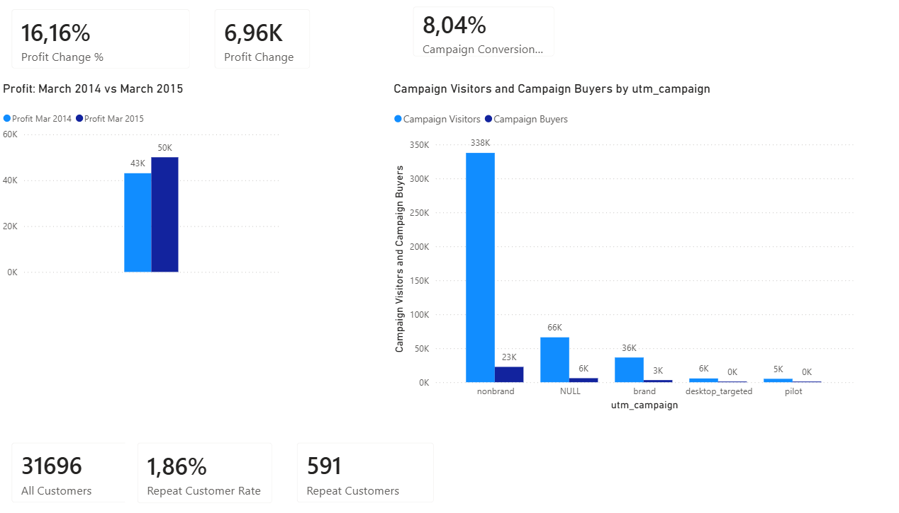

# **E-commerce Analysis**

## **Project Overview**
This project analyzes e-commerce performance using PostgreSQL and Power BI.
The goal of the analysis is to evaluate business performance, understand the effectiveness of marketing campaigns in attracting customers, and measure customer retention.
The analysis was first performed using SQL in PostgreSQL and then recreated in Power BI using DAX measures and data visualizations.

## **Business Legend**
The company wants to evaluate the results of its e-commerce initiatives. It uses advertising campaigns to attract customers. Therefore, management is seeking to assess the business results: changes in financial performance, how effective the campaigns are in attracting customers, and how many customers return.

## **Business Questions**
The analysis focuses on three main questions:
1. How did profit change in March 2015 compared with March 2014?
2. How many customers were attracted by marketing campaigns, and how many of them made a purchase?
3. What percentage of customers returned and made two or more purchases?

## **Tools Used**
**PostgreSQL** — data analysis and querying

**SQL** — joins, aggregations, CTEs, window functions, and customer analysis

**Power BI** — data modeling, DAX measures, KPI calculation, and visualization

## **Dataset**
The dataset contains e-commerce data about:
orders
order items
refunds
products
website sessions
website pageviews

## **Analysis** 

### 1. Profit Performance
The first analysis compared profit in March 2015 with the same month in the previous year.
|Metric|	Result|
|---|---:|
|Profit — March 2014|	$43.07K|
|Profit — March 2015|	$50.03K|
|Profit Change|	+$6.96K|
|Profit Growth|	+16.16%|

Finding: Profit increased by $6.96K, representing 16.16% year-over-year growth in March 2015.
This indicates improved financial performance compared with the same period in 2014.

### 2. Marketing Campaign Performance
Campaign performance was evaluated by comparing the number of unique visitors attributed to each campaign with the number of those users who made a purchase.
|Campaign| Visitors|	Buyers|	Conversion Rate|
|---|---:|---:|---:|
|nonbrand|	337 615|	22,640|	6.71%|
|brand|	36 439|	3 182|	8.73%|
|desktop_targeted|	5 590	|288|	5.15%|
|pilot|	5 095|	55|	1.08%|

Sessions with a NULL campaign value were excluded from campaign-level comparisons because they could not be attributed to a specific marketing campaign.

**Findings**:

- **nonbrand** generated the highest traffic volume and the largest number of buyers.
-	**brand achieved** the highest conversion rate at approximately 8.73%, despite generating substantially less traffic than nonbrand.
-	**desktop_targeted** converted approximately 5.15% of visitors.
-	**pilot** had the lowest conversion rate at approximately 1.08% and may require further investigation.

These results demonstrate an important distinction between campaign scale and campaign efficiency: nonbrand generated the most customers, while brand converted its traffic more efficiently.

### 3. Customer Retention
Customer retention was measured by identifying customers who placed at least two orders.
|Metric|	Result|
|---|---:|
|Unique Customers|	31 696|
|Repeat Customers|	591|
|Repeat Customer Rate|	1.86%|

Finding: Only 591 of 31 696 customers made two or more purchases, resulting in a 1.86% repeat customer rate.
This suggests that repeat purchasing represents a relatively small share of the customer base and could be explored further to identify opportunities for improving retention.

## Key Insights

- **Profit improved year over year:** March 2015 profit was **16.16% higher** than March 2014.
- **Nonbrand is the main acquisition driver:** it generated **337,615 visitors** and **22,640 buyers**.
- **Brand traffic converts more efficiently:** the brand campaign achieved the highest conversion rate at **8.73%**.
- **Pilot shows weak conversion performance:** its conversion rate was approximately **1.08%**.
- **Repeat purchasing is limited:** only **1.86%** of customers placed two or more orders.

## Business Recommendations

Based on the analysis:

- Investigate the strong conversion performance of the **brand** campaign and determine whether its reach can be expanded efficiently.
- Continue monitoring **nonbrand**, as it is the largest source of both traffic and buyers.
- Review the targeting and performance of the **pilot** campaign before increasing investment.
- Analyze repeat customers by acquisition channel, product, and first-order characteristics to better understand what drives repeat purchases.
- Consider additional retention analysis, such as cohort analysis, time between purchases, and customer lifetime value.

## Power BI Dashboard

The Power BI dashboard recreates the core SQL analysis using DAX and presents the results through business-focused KPIs and visualizations.

The dashboard includes:

- March 2014 vs. March 2015 profit comparison
- Absolute and percentage profit change
- Campaign visitors vs. buyers
- Campaign conversion rate
- Total customers
- Repeat customers
- Repeat customer rate
